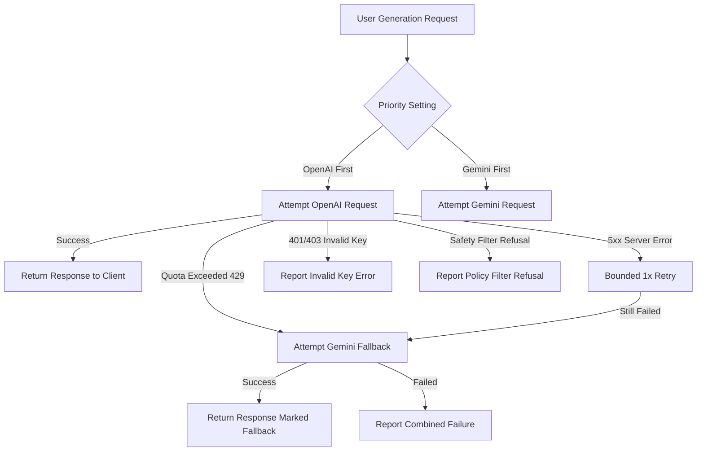

# AI Providers & Smart Router Guide

Faith & Creator Studio features an **OpenAI-First, Gemini-Fallback AI Router** with zero-leak AES-256-GCM encrypted storage for user keys.

---

## 1. OpenAI Setup

### How to Get an OpenAI API Key
1. Visit [platform.openai.com/api-keys](https://platform.openai.com/api-keys).
2. Sign in or create an account.
3. Click **Create new secret key**.
4. Name your key: `Faith Studio Key`.
5. Copy the generated key (starts with `sk-proj-...`).
6. In Faith & Creator Studio, navigate to **Settings ➔ AI Provider Settings** or the Onboarding page.
7. Paste your key, click **Test Connection**, and click **Save Key**.

### Supported OpenAI Models
- `gpt-4o`: Flagship multimodal model for title hooks, devotional captions, and design recommendations.
- `gpt-4o-mini`: Lightning fast and cost-efficient.
- `dall-e-3`: High-definition image generation (1792x1024 landscape, 1024x1792 portrait).

---

## 2. Google Gemini Setup

### How to Get a Google Gemini API Key
1. Visit [aistudio.google.com](https://aistudio.google.com/).
2. Sign in with the Google account you wish to use for Gemini API access.
3. Click **Get API key** in the left navigation.
4. Click **Create API key** (select a new or existing Google Cloud project).
5. Copy your key (starts with `AIzaSy...` or `AQ.Ab...`).
6. In Faith & Creator Studio, navigate to **Settings ➔ AI Provider Settings**.
7. Paste your key, click **Test Connection**, and click **Save Key**.

> **Note:** Signing in to the app with Google OAuth does **not** automatically grant Gemini API keys. Gemini API access is controlled through Google AI Studio quotas.

### Supported Gemini Models
- `gemini-1.5-flash`: Extremely fast, high throughput, generous free tier.
- `gemini-1.5-pro`: Deep multimodal reasoning.
- `gemini-2.0-flash-exp`: Experimental next-gen speed.

---

## 3. The Smart Router Architecture

### Key Router Principles
1. **Never Bypass Safety Refusals**: If a model flags content policy violation, the router does not attempt to bypass it with the other provider.
2. **Never Mask Invalid Keys**: If an API key is 401 Unauthorized, the error is immediately reported to the user so they can fix their key in Settings.
3. **Automatic Quota Failover**: If a 429 Rate Limit or Quota Exhaustion occurs during a live project creation, the request seamlessly routes to the configured fallback provider.
4. **Audit History Logged**: Every request logs latency, provider, model, and fallback state to the `generation_history` table.

---

## 4. Encryption at Rest (AES-256-GCM)

All API keys submitted by users are encrypted before reaching PostgreSQL:
- **Cipher**: AES-256-GCM (Authenticated Encryption)
- **IV**: 12 bytes random per key
- **Auth Tag**: 16 bytes authentication tag ensuring tamper detection
- **Secret**: 32-byte server secret configured via `ENCRYPTION_KEY` in `.env`
- **Frontend Safety**: Full API keys are never returned to the browser; only safe masked representations (e.g., `sk-proj...Kr4A`) are displayed.
