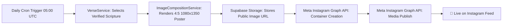

# Complete Guide: Automatic Daily Bible Verse Posting to Instagram

This guide provides step-by-step instructions to connect your **Instagram Business Account** with **Faith & Creator Studio** to automatically compose and publish verified Scripture posters daily.

---

## 📋 Overview of the Automatic Posting Pipeline



---

## STEP 1: Instagram Account Prerequisites

1. Open the Instagram app on your phone.
2. Go to your **Profile ➔ Settings and privacy ➔ Account type and tools**.
3. Switch your account to a **Professional Account** (choose **Business** or **Creator**).
4. Connect your Instagram account to a **Facebook Page**:
   - Go to **Edit Profile ➔ Page ➔ Connect or create a Facebook Page**.
   - *(A connected Facebook Page is required by Meta to grant Graph API publishing tokens).*

---

## STEP 2: Create a Meta App on Meta for Developers

1. Navigate to [developers.facebook.com](https://developers.facebook.com) and log in with your Facebook account.
2. Click **My Apps** (top right) ➔ **Create App**.
3. Choose **Other** ➔ click **Next**.
4. Select **Business** as the app type ➔ click **Next**.
5. Set:
   - **App Name**: `Faith Creator Studio Auto Post`
   - **App Contact Email**: Your email address
6. Click **Create app**.

---

## STEP 3: Add Instagram Graph API & Permissions

1. On your App Dashboard, find **Instagram Graph API** and click **Set up**.
2. Go to **Tools** (in top navigation) ➔ **Graph API Explorer**.
3. Under **Meta App**, select `Faith Creator Studio Auto Post`.
4. Under **User or Page**, select **Get User Access Token**.
5. In the **Permissions** dropdown, add these 4 required permissions:
   - `instagram_basic`
   - `instagram_content_publish`
   - `pages_show_list`
   - `pages_read_engagement`
6. Click **Generate Access Token** and approve the Facebook permissions dialog.

---

## STEP 4: Get Your Instagram User ID (IG Business ID)

In the Graph API Explorer query bar, paste and submit:
```http
GET me/accounts?fields=name,instagram_business_account
```
In the response, you will see your Facebook Page and your Instagram account details:
```json
{
  "data": [
    {
      "name": "Faith Media",
      "instagram_business_account": {
        "id": "17841400000000000"  <-- THIS IS YOUR INSTAGRAM_USER_ID
      },
      "id": "100000000000000"
    }
  ]
}
```
👉 Copy the `instagram_business_account.id` (this is your `INSTAGRAM_USER_ID`).

---

## STEP 5: Generate a Long-Lived Access Token (Never Expires)

Short-lived tokens expire in 1 hour. Follow these steps to generate a permanent or 60-day token:

1. In Graph API Explorer, click the **(i)** info icon next to the Access Token field.
2. Click **Open in Access Token Tool**.
3. Click **Extend Access Token** at the bottom to get a 60-day token.
4. To get a permanent Page Access Token:
   - Query: `GET me/accounts?fields=access_token`
   - The token returned next to your connected page is a **Page Access Token** that does not expire unless you change your Facebook password.

---

## STEP 6: Configure Automatic Daily Posting in GitHub Actions

The repository includes a pre-configured scheduled workflow:  
[`.github/workflows/daily-instagram-post.yml`](file:///c:/Users/Admin/Documents/bibel%20verse%20upload/.github/workflows/daily-instagram-post.yml)

### Add GitHub Secrets:
1. Open your repository on GitHub: `https://github.com/simatstransport/biblestudio`.
2. Go to **Settings ➔ Secrets and variables ➔ Actions**.
3. Click **New repository secret** and add:

| Secret Name | Value |
| :--- | :--- |
| `STUDIO_API_URL` | Your live Vercel URL (e.g. `https://faith-creator-studio.vercel.app`) |
| `INSTAGRAM_USER_ID` | Your Instagram Business ID from Step 4 (e.g. `17841400...`) |
| `INSTAGRAM_ACCESS_TOKEN` | Your Long-Lived Token from Step 5 (`EAA...`) |
| `CRON_SECRET` | Any secret random string (e.g. `faith_daily_cron_key_99`) |

### When will it run?
- **Automatically every day at 05:00 UTC** (10:30 AM IST / 1:00 AM EST).
- **Manual Trigger Anytime**: Go to GitHub **Actions ➔ Daily Instagram Scripture Post ➔ Run workflow** to test posting instantly!

---

## STEP 7: Manual API Test

You can test posting directly from PowerShell or terminal:

```bash
curl -X POST "http://localhost:5000/api/instagram/trigger-daily" \
  -H "Content-Type: application/json" \
  -d "{\"igUserId\": \"YOUR_IG_USER_ID\", \"accessToken\": \"YOUR_ACCESS_TOKEN\", \"languageMode\": \"bilingual\"}"
```

A response of `{"success": true, "mediaId": "18000..."}` confirms your post is live on your Instagram profile!
